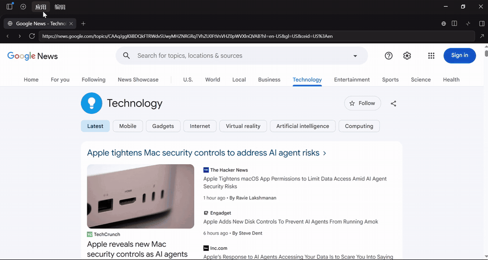
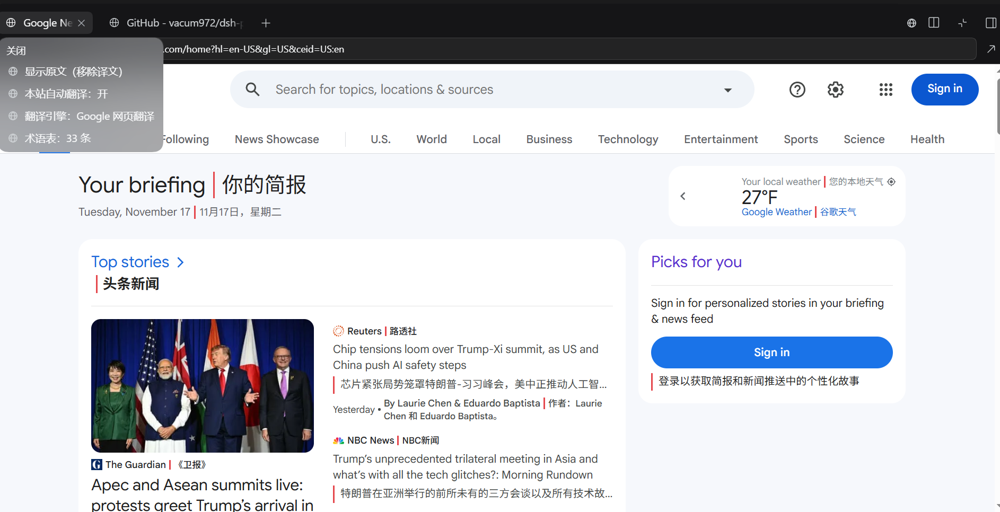
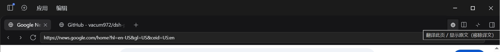
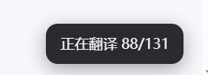
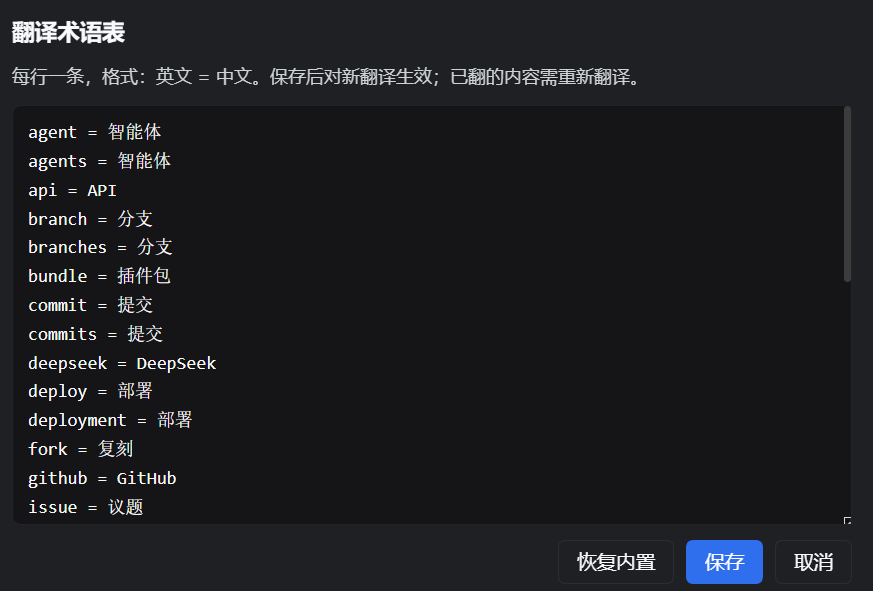
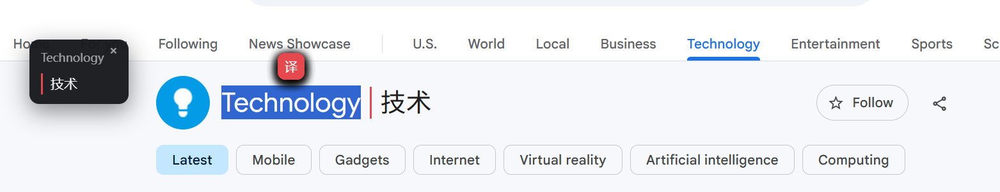

# 网页翻译 · dsh-page-translate

> **非官方社区插件**：本项目由社区成员独立开发和维护，与 DeepSeek 官方无关；第三方内容未经官方审核，使用前请自行评估风险。

> 在 DeepSeek Harness 右侧边栏的**浏览器**里，把网页翻成**双语对照**：原文保留，译文插到对应段落下面。
> 用法和沉浸式翻译一样：点一下，整页变成「原文 + 中文」，不丢内容、不跑版。

适合读英文文档、GitHub README / Issue、新闻站点、技术博客——尤其是那些**正文长、导航多**的页面。

<p align="center">
  
</p>

> 演示：右侧浏览器打开 Google News → 点翻译按钮 → 页面逐段出现中文译文；标签菜单里可以切换翻译引擎、
> 开关整站自动翻译。[完整录屏（MP4）](assets/screenshots/demo.mp4)

<p align="center">
  
</p>

> 上图：Google News 的 Technology 主题页——分类标题 `Technology | 技术`、新闻标题与摘要都在原文下插入中文译文
> （长标题另起一行带红色起始竖线，短标签如来源/署名同行追加）；标签「…」菜单里依次是 **显示原文**、
> **本站自动翻译**、**翻译引擎（当前 Google 网页翻译，点击可循环切换主题感知/Google/Bing）**
> 与 **术语表（33 条）**。

## 30 秒装上

```bash
# npm 安装（推荐）
dsh plugin --profile web add @vacum972/dsh-page-translate

# 或直接从 GitHub 源码安装
dsh plugin --profile web add github:vacum972/dsh-page-translate
```

Desktop 用户也可以在 DSH 的「插件中心」搜索 `@vacum972/dsh-page-translate` 一键安装；
本地开发时可以在插件管理器里用目录路径安装（bundle 就是一个普通 Loader 行 `page-translate`）。
装完刷新页面即可，无需 API Key、无需配置、无账号绑定。

## 怎么用

1. 在右侧边栏打开任意网页（标签栏在窗口右缘）。
2. 点面板标题栏里的**翻译按钮**（在分屏 / 全屏 / 收起三个按钮旁边，不占用它们的位置），
   或者用标签页的「…」菜单 → **翻译此页**。

<p align="center">
  
</p>

> 翻译按钮是标题栏里的第四个控件，悬停提示「翻译此页 / 显示原文（移除译文）」；它和分屏、全屏、收起并列，
> 全屏模式下也常驻。

3. 页面开始逐段显示译文：短标题/标签**同行追加**，长段落**另起一行**（带红色起始竖线）；
   右下角提示进度。
4. 再点同一个按钮 = **显示原文（移除译文）**。

<p align="center">
  
</p>

> 翻译过程中页面右下角显示进度，例如「正在翻译 88/131」，完成后显示已翻译段数并自动消失。

### 整站自动翻译

翻译一页后，该网站会被标记为「自动翻译」：之后这个站点的链接、新标签页、站内跳转都会在加载完成后自动翻译，
不用再点按钮。标签页「…」菜单里有开关行 **本站自动翻译：开/关**，选择按域名保存在本地。

### 滚动、懒加载也会继续翻

页面往下滚动、加载新卡片、点「加载更多」时，新出现的内容会在 1~2 秒内自动翻译；已经翻好的部分不会重复翻。

### 切换翻译引擎

标签页「…」菜单里的 **翻译引擎** 行循环切换（主题感知 → Google → Bing）：

- **主题感知（DeepSeek 模型，默认）**：客户端把待翻文本连同**页面标题、开头正文**（以及术语占位符）
  发给插件的 Host 路由 `/page-translate/model`，由 Host 用 DSH 当前默认模型翻译。模型知道“这页在讲什么”，
  多义词按页面语境处理（`film development` 在摄影页 → 胶片冲洗，不是电影开发）。
  **会消耗账号模型额度**（一页约几厘钱）；失败时自动回退 Google；
- **Google 网页翻译**：走 Host 路由代理 Google 网页接口，免费、无需 API Key，也是模型失败时的兜底；
- **Bing 直连**：直连微软 Edge 的匿名接口，不需要 Host 路由，最后兜底。

Google / Bing 两条**不花钱、不需要 API Key**；主题感知按 token 计费，切回前面两个就回到免费模式。
切换引擎后，插件会**自动清掉旧译文并用新引擎重翻当前页**——旧译文属于旧引擎，切换不会自动变。

### 术语表

术语表保证专有名词译法一致：`prompt` → 提示词、`agent` → 智能体、`pull request` → 拉取请求、
`issue` → 议题、`commit` → 提交，品牌名（DeepSeek、GitHub、npm、Markdown...）保持英文。
内置了一套技术文档常用词；标签页「…」菜单里的 **术语表** 行会打开编辑器（每行 `原文 = 译法`），
可以增删改。实现上先把术语替换成机翻不会动的占位符 `⟦G0⟧`，翻译后再还原成你指定的译法，
所以引擎既看不到、也不会翻错这些词。术语表按浏览器 profile 存在
`localStorage`（`dsh.page-translate.glossary`），并且参与翻译缓存 key——改完重新翻译即生效。

<p align="center">
  
</p>

> 上图：术语表编辑器（菜单「术语表」打开）——每行一条 `英文 = 中文`，可改可加；
> 内置 30+ 条技术文档常用词，底部有 **恢复内置 / 保存 / 取消**。

### 划词翻译

在已翻译的页面上选中 2~600 个字符，选区旁会出现红色 **译** 按钮；点一下弹出卡片显示
原文与译文，点 ×、按 Esc 或下次选择时关闭。划词翻译不修改页面内容，只做浮层展示。

<p align="center">
  
</p>

> 上图：选中 `Technology` → 选区上方出现红色「译」按钮 → 点击后弹出卡片，显示原文与译文
> （`Technology | 技术`），点 × 关闭。

## 为什么它不太会「翻坏页面」

插入策略刻意保守——宁可少翻，也不破坏布局：

- 只翻**自己拥有文本**的块元素（`p`、标题、引用、表格单元格、列表/`div` 里直接写着字的标签）；
  由多个链接拼成的容器不翻，避免把无关文字串成一行；
- 译文只作为**子节点插入**，不改页面任何内联样式、不移动原文，所以站点自己的布局不会被改动；
- 短文本/标题行内追加，长文本另起一行；渲染后被挤成「一字一列」的译文会直接丢弃；
- 顶部导航、粘性栏、`role="tablist"/"menu"` 不翻；正文区域的 `main`/`article` 内部才翻；
- 无障碍隐藏文本（`sr-only`、`aria-hidden`、tooltip 副本）跳过，不会翻出乱七八糟的隐藏文案；
- 每次翻译给元素打「运行 ID + 原文哈希」，只有哈希匹配才写入译文——站点重渲染也不会把译文放错位置；
- 页面侧用 `MutationObserver` 只报告「新增内容」，客户端增量翻译，并给已翻元素打标记，避免重复/错位。

## 翻译引擎与隐私

- **Google 路线**：客户端把文本发给插件自己的 Host 路由 `/page-translate/translate`，
  由 Host 代理 Google 网页翻译接口（`translate.googleapis.com`，非付费 API），最多 4 路并发；
- **Bing 路线**：渲染进程直接请求 `edge.microsoft.com` 的匿名接口；
- **术语表占位符**只用于在引擎侧保护术语，不会额外发送你的术语表内容到第三方；
- 页面文本只发送到上述翻译服务，**不写进 DSH 会话日志**，不保存、不上传 API Key；
- Host 路由只挂在 DSH 本机 Web 服务上（默认仅回环监听），不对局域网开放。

## 兼容与已知限制

- **仅 Desktop**：右侧浏览器在桌面端是 Electron `<webview>`；Web profile 里是跨域 `<iframe>`，
  插件无法注入，菜单会显示「当前页面无法翻译」；
- 只翻译当前文档的顶层块：跨域 iframe、canvas/PDF、图片里的文字不处理；
- 划词翻译与滚动续翻需要页面已经翻译过（插件脚本注入后才有划词按钮）；
- 免费匿名接口没有服务保障，可能限流或失效；失效时另一个引擎会自动兜底；
- 站点结构千差万别，保守规则会**故意跳过**一部分内容（多链接卡片、按钮、下拉菜单等），
  这是为了「不丢内容、不跑版」的取舍；遇到漏翻可以提 Issue 附截图；
- 依赖浏览器包提供的 guest 元素标记（`webview[data-sidebar-browser-frame="webview"]`）
  与面板 chrome 的按钮布局，DSH 大版本升级后可能需要回归；
- 插入的译文在页面刷新/跳转后消失，重新点一次翻译即可。

## 安装（开发者）

发布仓库根目录就是一个 DSH bundle：

```
index.js             Host 半体：/page-translate/translate 路由（Google 代理 + Harness 翻译兜底）
client.js            Client 半体：面板按钮、标签菜单行、页面采集/注入、自动翻译与续翻、引擎切换、术语表、划词翻译
cordis.patch.yml     bundle 补丁：插入 page-translate 行
locale/zh.json       插件管理页标题与描述（中文）
locale/en.json       同上（英文）
icon.svg             插件图标
```

本地安装：插件管理器里用目录路径安装本仓库（`install_bundle`），或
`dsh plugin --profile web add <本地路径>`。

## 许可

MIT
